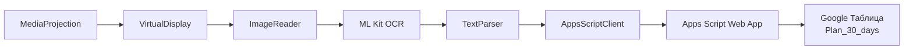
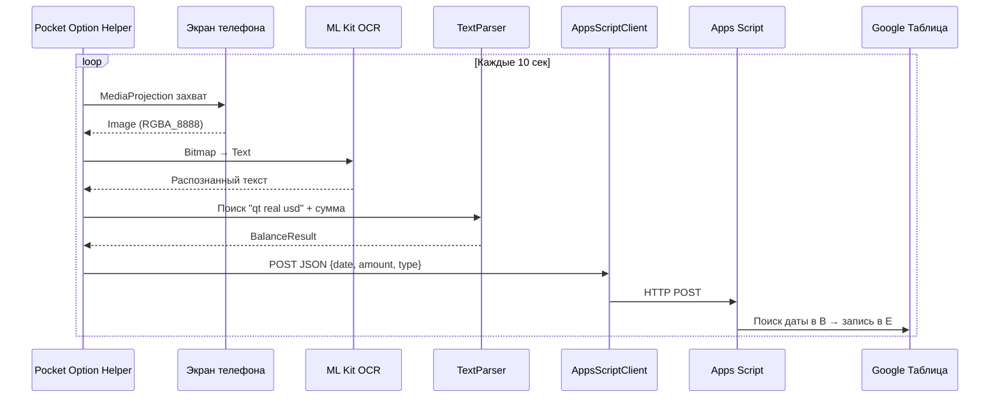

# Pocket Option Helper

<div align="center">


**Android-приложение для фонового мониторинга баланса Pocket Option и автоматической синхронизации с Google Таблицами через Apps Script**

[📥 Скачать последний APK](https://github.com/Lumus-0x/PocetOption_fix/releases/latest) • [📋 Полный CHANGELOG](CHANGELOG.md) • [🐛 Сообщить об ошибке](https://github.com/Lumus-0x/PocetOption_fix/issues)

</div>

---

## ✨ Особенности

| Функция | Описание |
|---------|----------|
| 🎥 **Фоновый захват экрана** | MediaProjection API + Foreground Service (каждые 10 сек) |
| 🔍 **OCR на устройстве** | ML Kit Text Recognition — 100% локально, без облака |
| 🧠 **Умный парсинг** | Ищет `qt real usd` / `qt demo usd` → извлекает ближайшие суммы |
| 📊 **Apps Script интеграция** | Простой HTTP POST — **нет OAuth, нет Google Sign-In** |
| 🔋 **Батарея-оптимизация** | Doze mode aware, исключение из оптимизации, WorkManager |
| 📱 **Android 14+ Ready** | Foreground service types, точные будильники, уведомления |

---

## 🏗 Архитектура



---

## 📁 Структура проекта

```
app_pocet/
├── app/
│   ├── src/main/
│   │   ├── java/com/pocet/screenmonitor/
│   │   │   ├── PocetApplication.kt           # Hilt Application
│   │   │   ├── MainActivity.kt               # Main UI & permissions
│   │   │   ├── di/
│   │   │   │   ├── AppModule.kt              # Hilt DI module
│   │   │   │   └── ServiceEntryPoint.kt      # EntryPoint для Services
│   │   │   ├── model/BalanceResult.kt        # Модель баланса
│   │   │   ├── service/
│   │   │   │   ├── ScreenCaptureService.kt   # Foreground service (core)
│   │   │   │   ├── OcrProcessor.kt           # ML Kit OCR pipeline
│   │   │   │   ├── TextParser.kt             # Логика извлечения баланса
│   │   │   │   ├── AppsScriptClient.kt       # HTTP клиент (OkHttp)
│   │   │   │   └── CaptureScheduler.kt       # WorkManager планирование
│   │   │   ├── receiver/BootReceiver.kt      # Boot completed
│   │   │   └── util/                         # Utils: Battery, Date, Crypto, Permissions
│   │   └── res/                              # Layouts, strings, themes, icons
│   └── build.gradle.kts
├── gradle/libs.versions.toml                 # Version catalog
└── build.gradle.kts
```

---

## ⚙️ Требования

| Требование | Версия |
|------------|--------|
| **Min SDK** | Android 8.0 (API 26) |
| **Target SDK** | Android 15 (API 35) |
| **Google Play Services** | Для ML Kit Text Recognition |
| **Интернет** | Для HTTP POST в Apps Script |

---

## 🚀 Быстрый старт (5 минут)

### 1️⃣ Создайте Apps Script в Google Таблице

1. Откройте вашу Google Таблицу (лист **`Plan_30_days`**)
2. **Расширения → Apps Script**
3. Вставьте код ниже:

```javascript
function doPost(e) {
  try {
    const data = JSON.parse(e.postData.contents);
    // data: { date: "DD.MM.YYYY", amount: "1234.56", accountType: "REAL" }
    
    const sheet = SpreadsheetApp.getActiveSpreadsheet().getSheetByName('Plan_30_days');
    if (!sheet) {
      return ContentService.createTextOutput('Error: Sheet "Plan_30_days" not found');
    }
    
    const dates = sheet.getRange('B:B').getValues().flat();
    const today = data.date; // Приходит как "06.11.2026"
    
    const row = dates.findIndex(d => {
      if (!d) return false;
      const cellDate = new Date(d);
      if (isNaN(cellDate.getTime())) return false;
      const day = String(cellDate.getDate()).padStart(2, '0');
      const month = String(cellDate.getMonth() + 1).padStart(2, '0');
      const year = cellDate.getFullYear();
      return `${day}.${month}.${year}` === today;
    }) + 1;
    
    if (row > 0) {
      sheet.getRange(`E${row}`).setValue(data.amount);
      return ContentService.createTextOutput('OK');
    } else {
      return ContentService.createTextOutput('Date not found: ' + today);
    }
  } catch (err) {
    return ContentService.createTextOutput('Error: ' + err.message);
  }
}
```

4. **Сохранить** (Ctrl+S) → назовите проект "Pocket Option Helper"
5. **Развернуть → Новое развёртывание → Тип: Веб-приложение**
   - ✅ **Выполнять от моего имени**
   - ✅ **У кого есть доступ: Все**
6. **Развернуть** → скопируйте **URL** (`https://script.google.com/macros/s/.../exec`)

### 2️⃣ Подготовьте таблицу (лист `Plan_30_days`)

| Колонка | Назначение | Формат |
|---------|------------|--------|
| **B** (строки 6–35) | Даты | `06.11.2026`, `2026-11-06`, `06/11/2026` |
| **E** | Сумма баланса | Записывается автоматически |

```
B6:  01.11.2026
B7:  02.11.2026
B8:  03.11.2026
...
B35: 30.11.2026
```

> ⚠️ **Критично**: Лист должен называться точно **`Plan_30_days`** (регистр важен!)

### 3️⃣ Введите URL в приложении

1. Откройте приложение
2. Нажмите **"URL Apps Script не задан"**
3. Вставьте URL → **Сохранить**
4. Нажмите **"Проверить соединение"** → ✅ "Соединение успешно!"

### 4️⃣ Установите APK (только GitHub Actions)

```bash
# Локальная сборка на ARM64 (Raspberry Pi) НЕ работает — используйте GitHub Actions
gh workflow run build.yml

# После сборки скачайте APK:
gh run download <run-id> -n app-debug

# Установите на устройство:
adb install app-debug.apk
```

**Или скачайте готовый APK из релиза:**
```
https://github.com/Lumus-0x/PocetOption_fix/releases/latest
```

### 5️⃣ Запустите на устройстве

1. **Откройте приложение** → проверьте URL (кнопка: "URL Apps Script задан ✓")
2. **Нажмите "Запросить все разрешения"**:
   - 🔋 Исключение из оптимизации батареи
   - ⏰ Точные будильники (Android 14+)
   - 🔔 Уведомления (Android 13+)
3. **Нажмите "Начать захват"** → разрешите запись экрана
4. ✅ Приложение работает в фоне, проверяет экран каждые 10 секунд

---

## 🔄 Как это работает



**Формат отправляемых данных:**
```json
{
  "date": "06.11.2026",
  "amount": "1234.56",
  "accountType": "REAL"
}
```

**Поддерживаемые форматы сумм на экране:**
- `$1,234.56` • `1,234.56` • `1234.56` • `1.234,56` (EU)

---

## 🛠 Ключевые детали реализации

### Foreground Service (Android 14+)
```xml
<service
    android:name=".service.ScreenCaptureService"
    android:foregroundServiceType="mediaProjection"
    android:exported="false"
    android:stopWithTask="false" />
```

### Жизненный цикл захвата
1. Пользователь разрешает запись экрана (системный диалог)
2. Сервис: `startForeground(type=mediaProjection)` → `MediaProjection` → `VirtualDisplay`
3. Каждые 10 сек: `ImageReader.acquireLatestImage()` → ML Kit → Parser → Apps Script

### OCR Pipeline
- **Input**: YUV_420_888 / RGBA_8888 Image от ImageReader
- **Convert**: MediaImage → Bitmap (downscale до 1920px max)
- **Recognize**: ML Kit Text Recognition (латиница)
- **Parse**: Блоки текста → ключевые слова → суммы ниже/рядом

### Защита от спама
- Минимум **1 минута** между успешными отправками в Apps Script
- Exponential backoff retry (max 3 попытки, base 1с, max 30с + jitter)

---

## 🔋 Оптимизация батареи

| Механизм | Реализация |
|----------|------------|
| **Doze Mode** | `REQUEST_IGNORE_BATTERY_OPTIMIZATIONS` через Settings Intent |
| **WorkManager** | Constraints: `NetworkType.CONNECTED` + `BatteryNotLow` |
| **Exact Alarms** | `SCHEDULE_EXACT_ALARM` (Android 14+) для точного планирования |
| **Min Interval** | 1 мин между записями — защита от частых пробуждений |

---

## 🐛 Устранение неполадок

| Проблема | Решение |
|----------|---------|
| 🛑 Сервис убивается в фоне | Отключите оптимизацию батареи + разрешите точные будильники |
| 🔍 OCR не находит текст | Проверьте яркость, убедитесь что текст "qt real usd" виден |
| ❌ Ошибка отправки (403) | Проверьте: URL Apps Script, доступ "Все", имя листа `Plan_30_days` |
| 📅 "Date not found" | Формат дат в колонке B должен парситься в Date объект |
| 📷 MediaProjection отклонён | Пользователь должен нажать "Начать запись" в системном диалоге |
| 🏷️ Sheet not found | Лист называется **точно** `Plan_30_days` (регистр!) |

### 📋 Отладка Apps Script
В Apps Script: **Выполнения (Executions)** → логи каждого POST:
- `OK` ✅ — успех
- `Date not found: 06.11.2026` — нет сегодняшней даты в колонке B
- `Error: Sheet "Plan_30_days" not found` — неверное имя листа
- `Error: ...` — проверьте код Apps Script

---

## 📜 Разрешения

| Разрешение | Назначение | Как запрашивается |
|------------|------------|-------------------|
| `FOREGROUND_SERVICE_MEDIA_PROJECTION` | Фоновый захват | Только Manifest |
| `MEDIA_PROJECTION` | Intent захвата экрана | Системный диалог |
| `INTERNET` | HTTP POST | Только Manifest |
| `REQUEST_IGNORE_BATTERY_OPTIMIZATIONS` | Защита от Doze | Settings Intent |
| `SCHEDULE_EXACT_ALARM` (API 34+) | Точное планирование | Settings Intent |
| `POST_NOTIFICATIONS` (API 33+) | Уведомление сервиса | Runtime диалог |

---

## 📚 Полезные ссылки

- [📖 Apps Script Web App Guide](https://developers.google.com/apps-script/guides/web)
- [🔍 ML Kit Text Recognition](https://developers.google.com/ml-kit/vision/text-recognition)
- [📱 MediaProjection API](https://developer.android.com/media/media-projection)
- [⏰ WorkManager](https://developer.android.com/topic/libraries/architecture/workmanager)
- [🛡️ Foreground Service Types](https://developer.android.com/develop/background-work/services/foreground-services)

---

## 📄 Лицензия

**MIT License** — свободно модифицируйте под свои торговые нужды.

---

<div align="center">

**Сделано для трейдеров Pocket Option** ❤️

[⬆ Наверх](#pocket-option-helper)

</div>